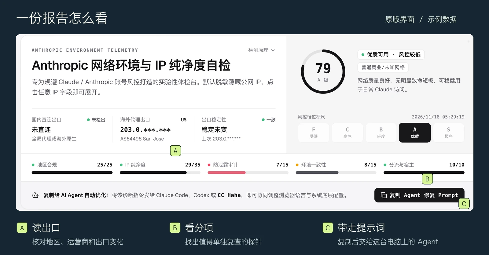
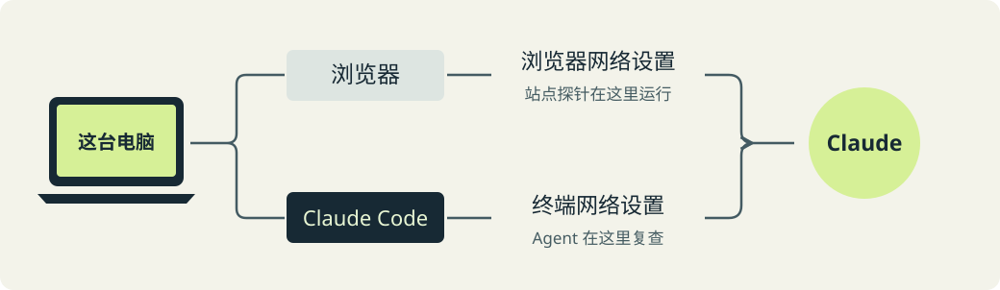

# CC Env

**检查这台电脑连接 Claude 时，网络卡在哪一步。** 在平时运行 Claude Code 的电脑上打开检测页，查看站点响应和网络出口。报告会生成一段可以复制的提示词，把这次观测带给终端里的 Agent。

**[打开 ccenv.app，检测当前网络 ↗](https://ccenv.app/)**　·　[本地运行](#本地运行)　·　[自托管](#自托管)



## 拿到报告以后

**先看具体域名。** 找到报告里的站点检测结果。网页打不开，先看 `claude.ai`；Claude Code 请求超时，重点看 `api.anthropic.com`。开发者控制台对应 `platform.claude.com`。浏览器探针能说明该次请求是否收到响应，账号登录和 API 鉴权还需要实际请求来验证。

**把这一次的结果交给 Agent。** 点击总览下方的 **「复制 Agent 修复 Prompt」**，粘贴到这台电脑上可用的 Claude Code 或 Codex。提示词会写入出口、DNS、WebRTC 等观测，以及根据本次报告生成的排查任务。下面三行节选自上图示例生成的提示词。

```text
- 综合评分：79/100（A 级 · 优质可用 · 风控较低）
- 出口归属地：US San Jose（普通商业/未知网络 · AS64496）
- DNS 状态：unknown（-）
```

这次总分是 79，但 DNS 仍然未知。如果你遇到的是 CLI 超时，粘贴后可以补一句：

> 我在这个终端运行 Claude Code 时连接超时。请先检查当前 shell 的代理配置、域名解析和 HTTPS 连接，告诉我哪一步出了问题。修改配置前先让我确认。

## 为什么浏览器通了，终端还要测？



浏览器扩展可以接管网页请求，启动 Claude Code 的 shell 则可能使用另一组代理变量。两边设置不同时，同一个域名也可能得到不同结果。调整后，在**原来报错的终端**重试同一条请求，再回网页点「重新检测」，就能对照哪一侧发生了变化。

<details>
<summary><strong>报告里每项数据来自哪里？</strong></summary>

| 读数 | 来源和用途 |
| --- | --- |
| 站点响应、耗时 | 浏览器分别向三个 Claude 域名发起请求，记录各自的结果。 |
| 出口 IP、地区、ASN | Cloudflare Pages Function 读取来访请求并查询 IP 情报。地理归属是服务商的估算。 |
| DNS、WebRTC、IPv4 / IPv6 | 客户端探针从不同通道观察出口。探针超时或未取得地址时，结论可能是未知。 |
| 分项评分、Agent 提示词 | 项目按本地规则汇总采集结果，并从本轮发现中组织排查任务。 |

检测会访问外部探针，查询 IP 情报时会将出口地址发送给第三方服务。[浏览器探针](./src/detectors/clientProbes.ts) · [出口查询](./functions/api/inspect.ts) · [评分规则](./src/engine/riskEngine.ts) · [提示词生成](./src/utils/agentPrompt.ts)

</details>

## 本地运行

准备 Node.js 22.12 或更高版本。安装时使用 `--legacy-peer-deps`，以兼容当前锁文件中 React 插件与 Vite 的版本声明。

```bash
git clone https://github.com/NanmiCoder/cc-env.git
cd cc-env
npm ci --legacy-peer-deps
npm run dev
```

打开 Vite 输出的本地地址。开发模式会把 `/api` 转发到 `ccenv.app`。要在本机一起调试前端和 Pages Functions，运行 `npm run cf:dev`。运行测试和生产构建分别使用 `npm test` 和 `npm run build`。

## 自托管

在自己的 Cloudflare 账号中准备 Pages 项目，把 `wrangler.toml` 和 `package.json` 的 `cf:deploy` 脚本里的项目名改成自己的名称，然后登录并部署。

```bash
npx wrangler login
npm run cf:deploy
```

部署内容包括 `dist/` 中的前端和 `functions/api/` 中的接口。需要持久缓存 IP 情报时，可添加名为 `IP_CACHE` 的 KV 绑定。[Wrangler 配置](./wrangler.toml) · [项目脚本](./package.json)
