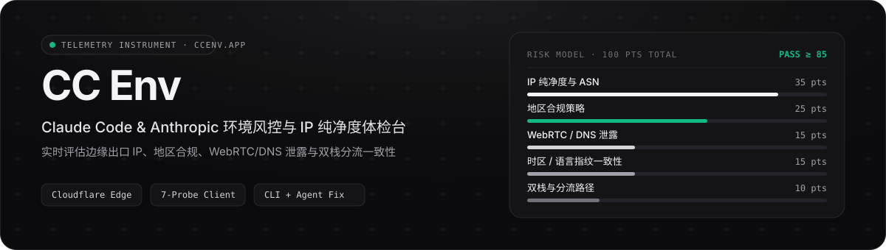
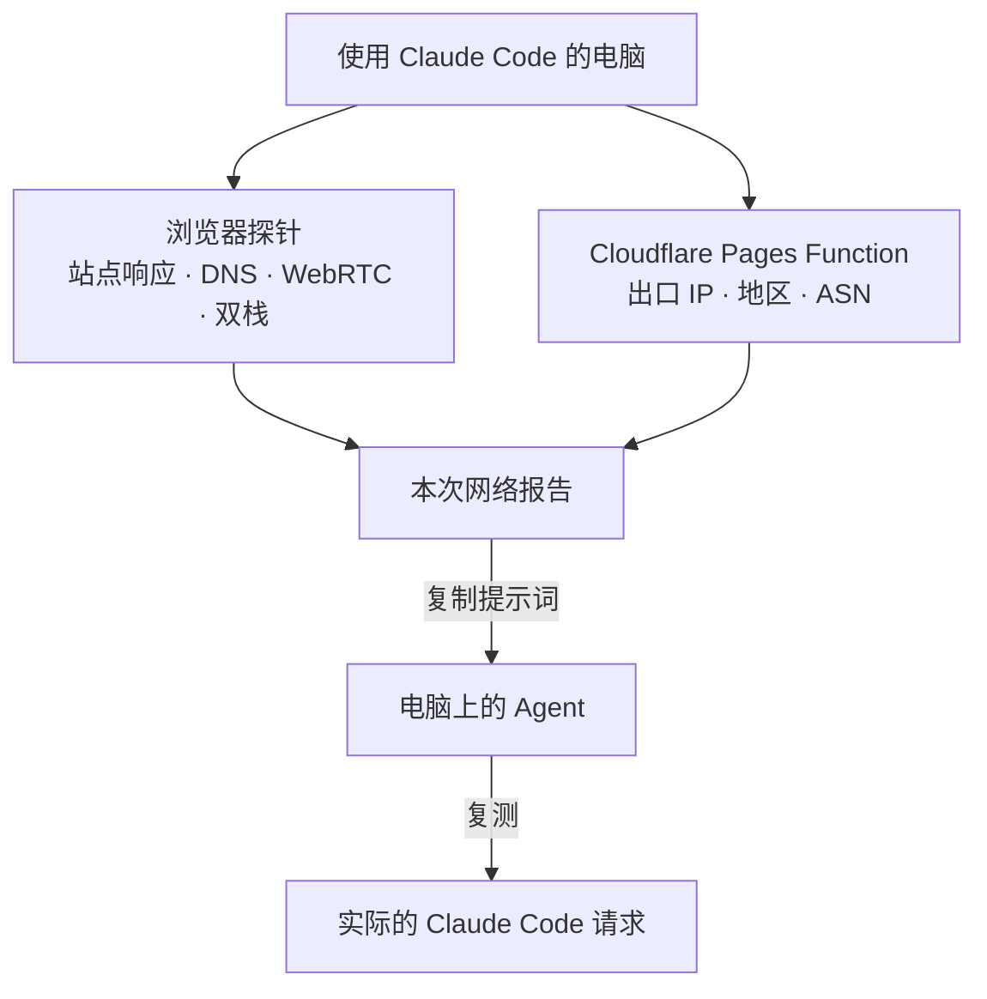

# CC Env · Claude 网络检测

在电脑上能打开 Claude 网页，Claude Code 却一直连接超时？CC Env 在浏览器里检查 Claude 站点和网络出口，再把这次检测写成一段提示词。你可以复制给本机的 Claude Code 或 Codex，接着查终端里的问题。

**[在这台电脑上开始检测 ↗](https://ccenv.app)**



## 从一次检测到终端排查

1. **在运行 Claude Code 的电脑上打开检测页。** 页面会自动检测。先看网页、API 和开发者控制台分别有没有响应，再看当前网络出口。
2. **点击「复制 Agent 修复 Prompt」。** 按钮在报告中。生成的提示词带有本次检测的出口地区、DNS、WebRTC 和待排查项。
3. **粘贴给这台电脑上可用的 Agent。** 在平时运行 CLI 的终端复查连接，确认需要修改的配置。调整后用原来的 CLI 请求再试一次，也可以回到网页点击「重新检测」对比结果。


## 看懂结果

| 你看到的现象 | 接下来查什么 |
| --- | --- |
| 网页有响应，CLI 仍然超时 | 浏览器与终端可能使用不同代理。让 Agent 检查当前 shell 的代理变量和 API 域名解析。 |
| 网页有响应，登录或 API 调用报错 | 浏览器探针只检查请求能否得到响应。用实际登录或 API 请求的错误信息判断下一步。 |
| DNS 或 WebRTC 显示未知 | 本轮探针收集到的信息有限。保留这项结果，结合网络出口和终端复测判断。 |

报告中的百分制评分来自项目自己的规则。确认 Claude Code 能否使用，以同一终端里的实际请求为准。

<details>
<summary><strong>检测数据从哪里来？</strong></summary>



检测会向 Claude 站点和外部网络探针发起请求，服务端也会向第三方 IP 情报服务查询出口地址。可以查看[浏览器探针](./src/detectors/clientProbes.ts)、[出口查询](./functions/api/inspect.ts)、[评分规则](./src/engine/riskEngine.ts)和[提示词生成逻辑](./src/utils/agentPrompt.ts)。

</details>

## 本地开发

使用 Node.js 22.12 或更高版本。在仓库目录运行以下命令。当前锁文件中 React 插件声明的 Vite 兼容范围较旧，安装时需要 `--legacy-peer-deps`。

```bash
npm ci --legacy-peer-deps
npm run dev
```

打开 Vite 输出的本地地址。开发服务器会把 `/api` 请求转发到 `https://ccenv.app`。需要同时调试本地 Pages Functions 时，运行 `npm run cf:dev`。本地模拟的出口信息可能与线上 Cloudflare 边缘节点观测到的不同。

```bash
npm test
npm run build
```

## 部署到 Cloudflare Pages

使用自己的 Cloudflare 账号登录 Wrangler，将 [wrangler.toml](./wrangler.toml) 和 [package.json](./package.json) 中 `cf:deploy` 的项目名改为自己的 Pages 项目名，然后运行：

```bash
npx wrangler login
npm run cf:deploy
```

静态文件输出到 `dist/`，接口由 `functions/api/` 提供。需要跨请求持久缓存 IP 情报时，可配置名为 `IP_CACHE` 的 KV 绑定。
