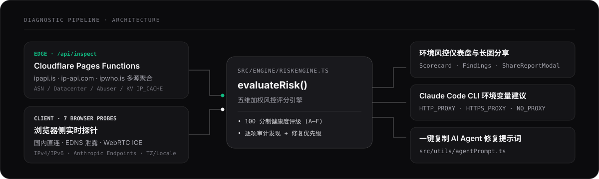

<p align="center">
  
</p>

<p align="center">
  <a href="https://ccenv.app"><strong>在线体检台 ccenv.app</strong></a> ·
  <a href="#检测架构与机制">检测机制</a> ·
  <a href="#快速开始与本地部署">快速开始</a> ·
  <a href="#cloudflare-pages-部署">Cloudflare 部署</a>
</p>

---

**CC Env** 是面向 **Claude Code** 与 **Anthropic API** 开发者的实时网络环境诊断平台。打开页面即自动采集边缘出口 IP 情报与浏览器侧 7 项网络探针，给出 100 分制风控健康度评级（`A–F`），并生成可直接复制使用的 CLI 代理环境变量与 AI Agent 修复提示词。

<p align="center">
  
</p>

## 为什么需要 CC Env

使用 Claude Code 或调用 Anthropic API 时，账号受限与连接异常往往不是单一“节点能不能通”，而是**出口地区政策、机房 ASN 风险、DNS/WebRTC 真实 IP 泄露、双栈分流不一致**叠加的结果。CC Env 将这些隐性风险量化为五个可验证维度：

| 评估维度 | 权重 | 核心检查项 | 代码实现 |
| :--- | :--- | :--- | :--- |
| **IP 纯净度与 ASN** | `35 分` | 住宅 / 机房 / 代理 / VPN / Tor / 滥用评分识别 | `functions/api/inspect.ts` |
| **地区合规策略** | `25 分` | Anthropic 一线支持区、普通支持区与受限地区判定 | `src/engine/riskEngine.ts` |
| **WebRTC / DNS 泄露** | `15 分` | EDNS 解析出口与 WebRTC ICE 候选地址泄露检测 | `src/detectors/clientProbes.ts` |
| **环境指纹一致性** | `15 分` | 浏览器时区、语言 Locale 与出口 IP 地理归属对齐 | `src/engine/riskEngine.ts` |
| **双栈与分流路径** | `10 分` | 国内直连出口、IPv4/IPv6 双栈分流及历史 IP 对比 | `src/detectors/clientProbes.ts` |

## 检测架构与机制

<p align="center">
  
</p>

1. **边缘侧情报聚合（`/api/inspect`）**：基于 Cloudflare Pages Functions 聚合 `ipapi.is`、`ip-api.com`、`ipwho.is` 等多源情报，并支持可选 Cloudflare KV（`IP_CACHE`）缓存。
2. **浏览器侧实时探针**：并发探测国内直连 IP（`myip.ipip.net`）、EDNS 解析归属（`edns.ip-api.com`）、WebRTC ICE、IPv4/IPv6 双栈与 Anthropic 端点连通性。
3. **可执行修复交付**：输出 `HTTP_PROXY` / `HTTPS_PROXY` / `NO_PROXY` 配置建议（`ClaudeCliAdvisor`）、长图诊断报告（`ShareReportModal`）及一键复制的 AI Agent 排障提示词（`src/utils/agentPrompt.ts`）。

## 快速开始与本地部署

直接访问线上版本：[**https://ccenv.app**](https://ccenv.app)

如需本地开发或自托管：

```bash
# 1. 安装依赖
npm install

# 2. 启动前端开发服务器（Vite）
npm run dev

# 3. 本地模拟完整 Cloudflare Pages + Functions 运行环境
npm run cf:dev
```

## Cloudflare Pages 部署

项目构建输出目录为 `dist`（见 `wrangler.toml`），内置 `/api/inspect`、`/api/lookup`、`/api/ping` 三个 Pages Functions 路由：

```bash
# 构建 TypeScript + Vite 产物并部署至 Cloudflare Pages
npm run cf:deploy
```

如需启用 IP 情报长期缓存，可在 Cloudflare Dashboard 创建 KV Namespace 后取消 `wrangler.toml` 中的 `IP_CACHE` 注释并填入 `id`。

## 技术栈

- **前端**：React 19 · TypeScript · Vite · Tailwind CSS v4 · Framer Motion · Lucide Icons
- **边缘后端**：Cloudflare Pages Functions（`functions/api/`）
